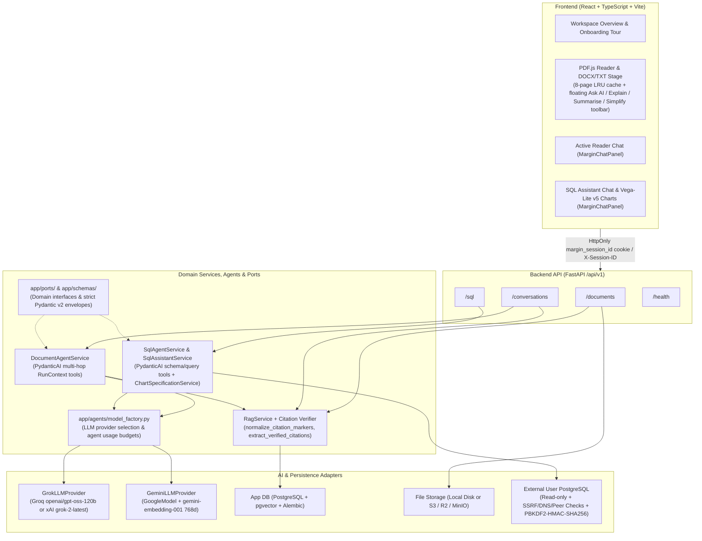

# Architecture Overview

Margin is a dual-engine workspace combining **Document Intelligence & Agentic RAG** with a **Natural Language SQL Assistant**, backed by FastAPI, PydanticAI, PostgreSQL, and a React + TypeScript frontend.

---

## System Diagram

---

## Request Lifecycles

### 1. Document Ingestion & Storage
1. Users upload PDF, DOCX, or TXT files to `POST /api/v1/documents`.
2. Margin validates file type/size (default limits: 20 MB per file via `MAX_UPLOAD_SIZE_BYTES`, 150 pages via `MAX_PAGES_PER_DOCUMENT`, and 25 documents per session via `MAX_DOCUMENTS_PER_SESSION`), persists the raw bytes via `FileStorageProtocol` (`LocalFileStorage` when `STORAGE_PROVIDER=local`, or `S3FileStorage` for AWS S3, Cloudflare R2, or MinIO when `STORAGE_PROVIDER=s3`), and parses content into location-aware text chunks while preserving page numbers and bounding/character offsets.
3. Chunks are embedded using Google Gemini embeddings (`gemini-embedding-001`, 768 dimensions) and indexed in PostgreSQL (`pgvector` HNSW cosine similarity).
4. Original documents can be streamed back for in-browser rendering via `GET /api/v1/documents/{document_id}/file`.

### 2. Document Q&A & Selection Q&A (`ChatMode`)
- **`document_qa`**: Supports single-document or multi-document scope (`document_ids`) inside a conversation thread. `DocumentAgentService` invokes a PydanticAI agent equipped with `RunContext` tools (`search_document_passages`, `read_document_page`, `list_workspace_documents`, `get_document_metadata`) and falls back cleanly to standard vector RAG (`RagService`) when needed.
- **`selection_qa`**: Triggered from the interactive reader's floating selection toolbar (**Ask AI**, **Explain**, **Summarise**, **Simplify**). Margin wraps the selected text in `<selected_passage>` alongside surrounding document context in `<document_source>` / `<retrieved_sources>` blocks so ambiguous references (*"this clause"*, *"the above table"*) resolve accurately.
- **Citation Normalization & Verification**: Provider-specific citation tags (e.g., `【1†L1-L4】`) are normalized via `normalize_citation_markers` into `[N]` markers, verified against retrieved chunks by `extract_verified_citations`, and rendered as clickable citation pills that jump directly to the cited page and highlight matching text. Optional follow-up suggestions are normalized with `strip_followup_label_prefixes`.

### 3. Natural Language SQL Assistant
1. Users connect an external PostgreSQL replica via `POST /api/v1/sql/connections`. Credentials are encrypted at rest with PBKDF2-HMAC-SHA256 (100,000 iterations) + counter-mode HMAC-SHA256.
2. On connection and every query, Margin performs SSRF protection: offloaded DNS lookup via `asyncio.to_thread`, private/loopback/link-local/metadata IP blocking (including IPv6-mapped IPv4 unwrapping), and post-connect peer verification (`_verify_connected_peer_is_public`).
3. `SqlAgentService` / `SqlAssistantService` uses PydanticAI schema-inspection and read-only execution tools (`inspect_table_schema`, `execute_sql_query`) with strict single-`SELECT` / `WITH ... SELECT` lexical validation, `SET SESSION CHARACTERISTICS AS TRANSACTION READ ONLY`, and `SET LOCAL statement_timeout`.
4. `ChartSpecificationService` attaches inline **Vega-Lite v5** `vega_lite_spec` chart configurations in `SqlQueryTurnResponse.chart_suggestion` rendered directly inside `MarginChatPanel`.

---

## Security & Session Isolation
- **Session Scoping**: Browser sessions use an `HttpOnly` `margin_session_id` cookie (`SameSite=Lax`), with `X-Session-ID` header support for API clients and automated tests. All `/api/v1/documents`, `/api/v1/conversations`, and `/api/v1/sql` resources are strictly partitioned by session.
- **Server-Side AI Keys**: Groq, xAI Grok, and Google Gemini API credentials reside exclusively on the backend (`LLM_PROVIDER`, `XAI_API_KEY` / `GROK_API_KEY` / `GROQ_API_KEY`, `GEMINI_API_KEY`).
- **Strict Pydantic Contracts**: API payloads and domain envelopes live in `app/schemas/` using strict validation (including `extra="forbid"` on request/response contracts).
